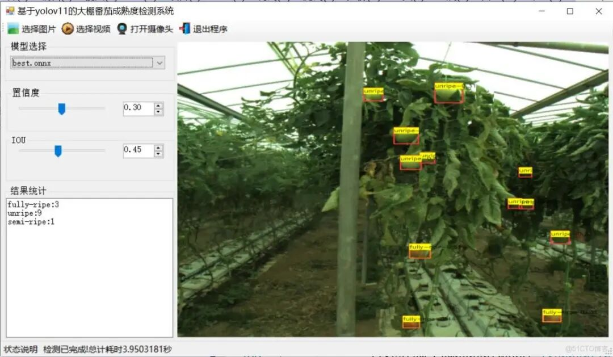
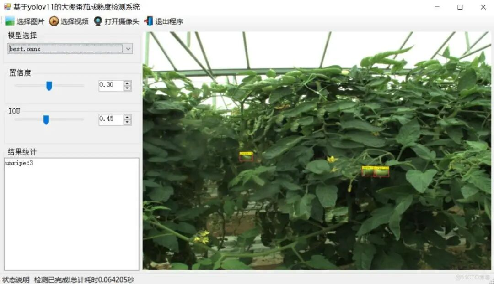
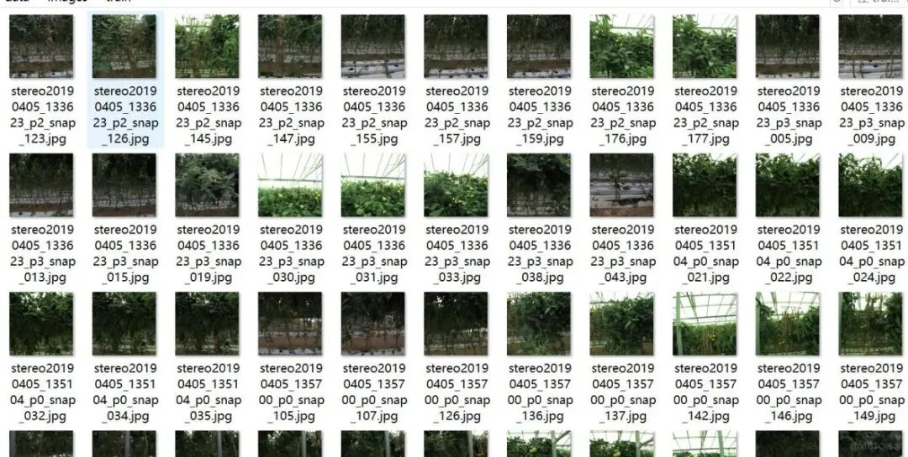
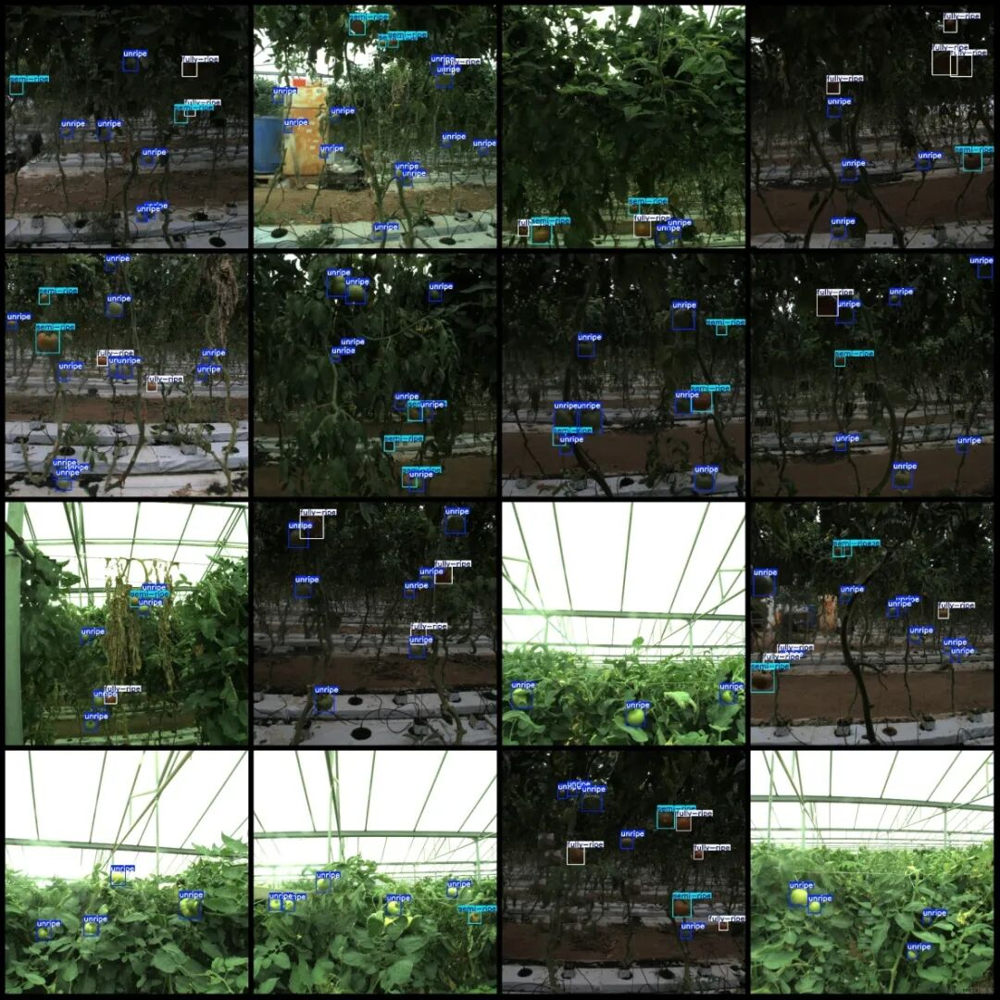

# [C#][winform] Tomato Maturity Detection System Based on YOLOv11 in Greenhouses C# Source Code + ONNX Model + Evaluation Indicator Curve + High-quality GUI Interface

[Algorithm Introduction]At a critical period of the rapid development towards intelligent and refined agriculture greenhouse planting, precisely and efficiently monitoring the ripeness status of tomatoes in the greenhouse has become...

[Algorithm Introduction]

During the critical period of agricultural greenhouse cultivation towards intelligent and meticulous directions, accurately and efficiently monitoring the ripeness status of greenhouse tomatoes has become one of the core challenges to ensure planting benefits, improve agricultural product quality, and optimize picking plans. The greenhouse environment is complex and variable, and tomato plant growth conditions are diverse. States such as leaf morphology at different growth stages, fruit size changes, and fruit positioning not only intuitively reflect the current growth health of the tomato but are also closely related to the overall income of growers and the stability of market supply. Once there are abnormalities in tomato ripeness, such as some fruits prematurely or late maturing, or diseases causing uneven ripening, if not detected in time and appropriate measures taken, it can easily lead to fruit rotting, quality decline, and even affect the yield of the entire greenhouse, causing significant economic losses for growers.

Traditional greenhouse tomato maturity detection methods primarily rely on manual inspections. However, due to the continuous expansion of greenhouse scales, the increasing number of tomato plants, and the complex layout of greenhouse space, manual inspections are difficult to comprehensively cover all areas of the greenhouse, especially those tomatoes that are hidden deep within the plants or in corners, which are often overlooked in a timely manner. Moreover, early monitoring methods based on simple color determination, due to the diverse tomato varieties leading to varying color expressions, unstable lighting conditions inside the greenhouse, and various plant branches obstructing views, have a misjudgment rate of over 30%, completely failing to meet the management needs of growers for "precision and zero errors." Therefore, developing an intelligent detection system for greenhouse tomato maturity with high precision, strong adaptability, and real-time monitoring has become a key technological breakthrough point in enhancing planting management levels and benefits.

Current technology has several significant bottlenecks: manual inspection is not only extremely inefficient (a single person can only observe a limited number of tomato plants per day), but also poses risks such as being scratched by leaves and fatigue from long periods of work; traditional algorithms based on simple color and shape segmentation struggle to accurately distinguish the normal maturity state of tomatoes from abnormal states (such as changes in color due to diseases), and their performance drops sharply in low-visibility environments like dim lighting or high humidity in greenhouses. Traditional object detection models are less adaptable to the diversity of tomato growth (such as size changes during different stages of growth and differences in morphology among different varieties) and scale variations (from the compactness of immature fruits to the fullness of mature ones), with an overestimation rate of more than 40% for small targets (like young tomatoes just starting to ripen), making it difficult to meet the complex demands of practical planting scenarios.

The tomato ripeness detection system based on YOLOv11 for greenhouses has brought revolutionary changes to agricultural planting management. As an advanced target detection algorithm, YOLOv11 possesses strong feature extraction and real-time detection capabilities. This system fully leverages the end-to-end real-time detection advantages of YOLOv11 and has been deeply optimized for the complex environment of greenhouses.

This system can accurately identify the maturity categories of tomatoes, specifically covering:

-

Unripe: Accurately captures the morphological characteristics of tomatoes at an unripe stage, such as their green color and firmer fruit texture, to help growers understand the tomato's growth progress and plan subsequent management measures accordingly.

-

Semi-ripe (half ripe): Real-time monitoring of the state of tomatoes at this stage, when the color begins to change and the texture also changes. The system can accurately determine it, providing a basis for growers to determine the optimal time for harvest preparation.

-

fully - ripe (completely ripe): sensing the characteristics of tomatoes when fully ripe, such as bright colors, full and slightly elastic fruits, to ensure that growers can harvest at the best quality of tomatoes, and improve the market value of agricultural products.

Through the learning and training of a large amount of tomato ripeness image data, The system can maintain a high detection accuracy. At the same time, The system has strong anti-interference capability. Can effectively deal with the branches and leaves in the greenhouse. Interference factors such as the support, etc. Provided solid technical support for the construction of new intelligent plant greenhouses. Assisting growers to achieve high efficiency. Precise Scientific planting management.

[Effect Display]





The model can detect the category.

unripe semi-ripe fully-ripe

[Training Dataset Introduction]

Dataset format: YOLO format (txt file without split path, only contains jpg images and yolo format txt files)

Number of images (number of jpg files): 279

Number of annotations (number of xml files): 279

Number of annotations (number of txt files): 279

Labeling category count: 3

Label category names (Note that the order of yolo format categories does not correspond to this, but is based on the labels folder's classes.txt): ["unripe", "semi-ripe", "fully-ripe"]

Number of boxes labeled in each category:

Unripe frame count = 1593

Semi-ripe box count = 397

fully-ripe frame count = 431

Total frame count: 2421

Using labelImg:

Annotation rules: Draw a rectangle around the category.

Important Notice: No

Special : This dataset does not guarantee the accuracy or precision of the trained models or weight files. The dataset is provided with accurate and reasonable annotations only.

Image Preview:



Annotation example:



[Training Information]


Parameters


Value


Number of training set images


263


Number of images in the validation set


14


Training map


87.8%


Training Accuracy


80.3%


Training recall rate


87.6%


[Validation set accuracy statistics]


Class


Images


Instances


P


R


mAP50


mAP50-95


all


14


103


0.803


0.876


0.878


0.59


unripe


13


64


0.866


0.984


0.967


0.619


semi-ripe


8


17


0.63


0.703


0.725


0.514


fully-ripe


11


22


0.912


0.942


0.942


0.636


[Test Environment]

Windows 10 x64 system, VS2019, netFramework4.7.2, OpenCVSharp4.9.0, ONNXRuntime1.22.0

Please note that CPU inference is used, and CUDA inference is not required. Therefore, the computer does not need an NVIDIA graphics card, and installation of CUDA+DUNN is not necessary.

[Interface Design]

```
using DeploySharp.Data;
using OpenCvSharp;
using System;
using System.Collections.Generic;
using System.ComponentModel;
using System.Data;
using System.Diagnostics;
using System.Drawing;
using System.IO;
using System.Linq;
using System.Text;
using System.Threading;
using System.Threading.Tasks;
using System.Windows.Forms;
namespace FIRC
{
public partial class Form1 : Form
{
public bool videoStart = false;//video stop flag
string weightsPath = Application.StartupPath + "\\weights";//Model directory
YoloDetector detector = new YoloDetector();//Inference engine
public Form1()
{
InitializeComponent();
CheckForIllegalCrossThreadCalls = false;// Thread updates control without error
}
private void LoadWeightsFromDir()
{
var di = new DirectoryInfo(weightsPath);
foreach(var fi in di.GetFiles("*.onnx"))
{
comboBox1.Items.Add(fi.Name);
}
if(comboBox1.Items.Count>0)
{
comboBox1.SelectedIndex = 0;
}
else
{
tssl_show.Text = "Model not found. Please close the program and put the model into the weights folder!";
tsb_pic.Enabled = false;
tsb_video.Enabled = false;
tsb_camera.Enabled = false;
}
}
private void Form1_Load(object sender, EventArgs e)
{
LoadWeightsFromDir(); // Load model from directory
}
public string GetResultString(DetResult[] result)
{
Dictionary<string, int> resultDict = new Dictionary<string, int>();
for (int i = 0; i < result.Length; i++)
{
if(resultDict.ContainsKey( result[i].Category) )
{
resultDict[result[i].Category]++;
}
else
{
resultDict[result[i].Category] =1;
}
}
var resultStr = "";
foreach(var item in resultDict)
{
resultStr += string.Format("{0}:{1}\r\n",item.Key,item.Value);
}
return resultStr;
}
private void tsb_pic_Click(object sender, EventArgs e)
{
OpenFileDialog ofd = new OpenFileDialog();
ofd.Filter = "*.*|*.bmp;*.jpg;*.jpeg;*.tiff;*.tiff;*.png";
if (ofd.ShowDialog() != DialogResult.OK) return;
tssl_show.Text = "Detecting......";
Task.Run(() => {
var sw = new Stopwatch();
sw.Start();
Mat image = Cv2.ImRead(ofd.FileName);
detetor.SetParams(Convert.ToSingle(numericUpDown1.Value), Convert.ToSingle(numericUpDown2.Value));
var results=detetor.Inference(image);
var resultImage = detetor.DrawImage(image, results);
sw.Stop();
pb_show.Image = OpenCvSharp.Extensions.BitmapConverter.ToBitmap(resultImage);
tb_res.Text = GetResultString(results);
tssl_show.Text = "Detection completed! Total elapsed time is "+sw.Elapsed.TotalSeconds+" seconds";
});
}
public void VideoProcess(string videoPath)
{
Task.Run(() => {
detetor.SetParams(Convert.ToSingle(numericUpDown1.Value), Convert.ToSingle(numericUpDown2.Value));
VideoCapture capture = new VideoCapture(videoPath);
if (!capture.IsOpened())
{
tssl_show.Text="Video failed to open!";
return;
}
Mat frame = new Mat();
var sw = new Stopwatch();
int fps = 0;
while (videoStart)
{
capture.Read(frame);
if (frame.Empty())
{
Console.WriteLine("data is empty!");
break;
}
sw.Start();
var results = detetor.Inference(frame);
var resultImg = detetor.DrawImage(frame,results);
sw.Stop();
fps = Convert.ToInt32(1 / sw.Elapsed.TotalSeconds);
sw.Reset();
Cv2.PutText(resultImg, "FPS=" + fps, new OpenCvSharp.Point(30, 30), HersheyFonts.HersheyComplex, 1.0, new Scalar(255, 0, 0), 3);
//Display results
pb_show.Image = OpenCvSharp.Extensions.BitmapConverter.ToBitmap(resultImg);
tb_res.Text = GetResultString(results);
Thread.Sleep(5);
}
capture.Release();
pb_show.Image = null;
tssl_show.Text = "Video has stopped!";
tsb_video.Text = "Select Video";
});
}
public void CameraProcess(int cameraIndex=0)
{
Task.Run(() => {
detetor.SetParams(Convert.ToSingle(numericUpDown1.Value), Convert.ToSingle(numericUpDown2.Value));
VideoCapture capture = new VideoCapture(cameraIndex);
if (!capture.IsOpened())
{
tssl_show.Text = "Camera failed to open!";
return;
}
Mat frame = new Mat();
var sw = new Stopwatch();
int fps = 0;
while (videoStart)
{
capture.Read(frame);
if (frame.Empty())
{
Console.WriteLine("data is empty!");
break;
}
sw.Start();
var results = detetor.Inference(frame);
var resultImg = detetor.DrawImage(frame, results);
sw.Stop();
fps = Convert.ToInt32(1 / sw.Elapsed.TotalSeconds);
sw.Reset();
Cv2.PutText(resultImg, "FPS=" + fps, new OpenCvSharp.Point(30, 30), HersheyFonts.HersheyComplex, 1.0, new Scalar(255, 0, 0), 3);
//Display results
pb_show.Image = OpenCvSharp.Extensions.BitmapConverter.ToBitmap(resultImg);
tb_res.Text = GetResultString(results);
Thread.Sleep(5);
}
capture.Release();
pb_show.Image = null;
tssl_show.Text = "Camera has been stopped!";
tsb_camera.Text = "Open Camera";
});
}
private void tsb_video_Click(object sender, EventArgs e)
{
if(tsb_video.Text=="Select video")
{
OpenFileDialog ofd = new OpenFileDialog();
ofd.Filter = "video files (*.*)|*.mp4;*.avi";
if (ofd.ShowDialog() != DialogResult.OK) return;
videoStart = true;
VideoProcess(ofd.FileName);
tsb_video.Text = "Stop";
tssl_show.Text = "Video is being detected...";
}
else
{
videoStart = false;
}
}
private void tsb_camera_Click(object sender, EventArgs e)
{
If (tsb_camera.Text == "Open Camera")
{
videoStart = true;
CameraProcess(0);
tsb_camera.Text = "Stop";
tssl_show.Text = "Camera is detecting...";
}
else
{
videoStart = false;
}
}
private void tsb_exit_Click(object sender, EventArgs e)
{
videoStart = false;
this.Close();
}
private void trackBar1_Scroll(object sender, EventArgs e)
{
numericUpDown1.Value = Convert.ToDecimal(trackBar1.Value / 100.0f);
}
private void trackBar2_Scroll(object sender, EventArgs e)
{
numericUpDown2.Value = Convert.ToDecimal(trackBar2.Value / 100.0f);
}
private void numericUpDown1_ValueChanged(object sender, EventArgs e)
{
trackBar1.Value = (int)(Convert.ToSingle(numericUpDown1.Value) * 100);
}
private void numericUpDown2_ValueChanged(object sender, EventArgs e)
{
trackBar2.Value = (int)(Convert.ToSingle(numericUpDown2.Value) * 100);
}
private void comboBox1_SelectedIndexChanged(object sender, EventArgs e)
{
tssl_show.Text="Loading model:" + comboBox1.Text;
detetor.LoadWeights(weightsPath+"\\"+comboBox1.Text);
tssl_show.Text = "Model loading completed!";
}
}
}
```

[Common Evaluation Parameters Introduction]

In the task of object detection, evaluating the performance of a model is crucial. The terms you mentioned are commonly used metrics for assessing the performance of a model. Here are detailed explanations of these terms:

1. **Class**

:

-

This usually refers to the categories of objects that the model is designed to detect. For example, a model may be trained to detect different categories of objects such as vehicles, pedestrians, or animals.

1. **Images**

:

-

Represents the number of images in the validation set. The validation set is a dataset used to evaluate model performance, separate from the training set to ensure fairness in evaluation results.

1. **Instances**

:

-

The total number of target objects in all images. This includes the sum of all category objects, for example, if the validation set contains 100 images, each image has an average of 5 target objects, then Instances is 500.

1. **P (Precision)**

:

-

Precision is the proportion of actual positive samples predicted by the model. The formula is: Precision = TP / (TP + FP), where TP represents true positives (True Positives) and FP represents false positives (False Positives).

1. **R (Recall)**

:

-

Recall is the proportion of all true positives correctly predicted by the model. The formula is: Recall = TP / (TP + FN), where FN represents false negatives.

1. **mAP50**

:

-

Mean Average Precision (mAP) at an IoU threshold of 0.5, where IoU is the metric used to measure the degree of overlap between predicted bounding boxes and ground truth bounding boxes. mAP is a comprehensive metric that considers both precision and recall when evaluating model performance across different recall levels. At an IoU of 0.5, if the overlap between the predicted bounding box and the ground truth bounding box reaches or exceeds 50%, it is considered correct.

1. **mAP50-95**

:

-

This represents the average accuracy of the model across IoU values ranging from 0.5 to 0.95 (with a step of 0.05). This is a more stringent evaluation criterion, demanding higher overlap between predicted bounding boxes and ground truth boxes. In object detection tasks, higher IoU thresholds mean that models need to be more accurate in their target object localization. The computation of mAP50-95 takes into account multiple IoU thresholds ranging from lenient to strict, thus providing a more comprehensive assessment of the model's performance.

These indicators collectively form an important framework for evaluating the performance of target detection models. By comparing the performance of different models on these indicators, It can be determined which model may be more effective in practical applications.

[Usage Steps]

Usage Steps: (1) First, install the YOLOv11 environment according to the official framework ultralytics installation tutorial, and then convert your own pt model into an ONNX model using the official export command. Then, go to the GitHub repository futureflsl/firc-csharp-projects to find the source code. (2) Open the Sln project in Visual Studio 2019, select x64 release, and modify some necessary parameters such as input shape, etc., and then click run to view the final result.

Please note that if there are any runtime errors, refer to my blog for re-invoking the DLL of my source code: [C#] OpenCVSharp error System.Memory, Version=4.0.1.2, Culture=neutral, PublicKeyToken=cc7b13fcd2ddd51 "Version higher than the referenced_ failed to load file or assembly" "system.memory, version=4.0.1.2, culture-CSDN blog

[Provided Files]

C# Source Code

yolo11n.onnx model (provided with PyTorch model)

Training map, P, R curve graph (in weights\results.png)

Test images (under test_img folder)

Please note that the provided training dataset is here.


## Payment

Here is a pay link on Stripe ( https://buy.stripe.com/3cs8yP7sY87d0vu9AB ). Please contact me lonlonago@foxmail.com after funding $89, and I will send you a complete data files , thank you!


